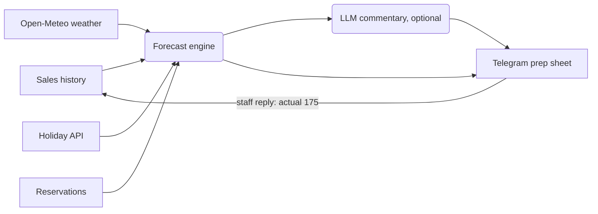

# Restaurant Demand Forecasting Agent

An AI agent that tells a restaurant kitchen **how many portions of each dish to prepare today**. It runs every morning, sends the prep list to Telegram, and learns from the real sales numbers staff reply with.

Built for and **used daily in a real restaurant**, where the kitchen plans its preparation from the forecast and food waste is now below 5%.

> The data in this repository is **synthetic demo data** with the same structure as the real data. Real sales figures are not published.

## What it does

1. **07:00 every day** (GitHub Actions) the agent gathers the inputs for today:
   - sales history per weekday (`agent/stats.json`)
   - weather forecast (Open-Meteo API)
   - German public holidays (Nager.Date API)
   - reservations (optional reservations API)
2. Calculates per-dish portions for 8 dishes (plov, manty, samsa, lagman…) plus an expected volume level: LIGHT, NORMAL or HEAVY.
3. Optionally adds a short commentary from an LLM (Llama 3.1 via Ollama locally, or Groq in the cloud).
4. Sends the prep sheet to the kitchen's Telegram chat.
5. Staff reply `actual 175` with yesterday's real total; the next run ingests it and commits the updated stats back to the repo, so the model keeps learning.



## Two models

**`agent/predict_agent.py` – daily production agent**
Recency-weighted average per weekday with outlier dampening, adjusted by rules for holidays (+20%), rain (−12%), heat (−10%), good weather (+5%) and large reservations, plus a 10% safety buffer.

**`model/model.py` – statistical demand model** (pure Python, no libraries)
- **Total volume:** multiplicative decomposition, `level(trend) × weekday factor × weather × uplift`, with a robust trend through the series.
- **Dish mix:** each dish's share of sales is regressed on time, temperature and rain using **ridge-regularised weighted least squares** (weights = recency × sample size). This captures effects like "lagman soup sells more when it's cold and wet".
- **Backtesting:** leave-one-out evaluation reports MAPE so accuracy can be tracked as data grows. On the real restaurant data the model reached about 18% MAPE (median error about 12%) after four weeks.

```bash
python model/model.py --date 2026-10-03 --tmax 15 --precip-mm 4 --reserved-guests 12
python model/model.py --explain     # what the model has learned
python model/model.py --backtest    # accuracy check
```

## Run it

```bash
cd agent
pip install -r requirements.txt
python predict_agent.py --dry-run   # print the forecast instead of sending
python predict_agent.py --report    # backtest accuracy
```

To send to Telegram, set the environment variables `PREDICT_BOT_TOKEN` and `PREDICT_CHAT_ID`. For local LLM commentary set `OLLAMA_URL=http://localhost:11434`, or set `GROQ_API_KEY` for the cloud.

### Run free on GitHub Actions
Add `PREDICT_BOT_TOKEN`, `PREDICT_CHAT_ID` and optionally `GROQ_API_KEY` under **Settings → Secrets and variables → Actions**. The workflow in `.github/workflows/daily-forecast.yml` runs every morning and can also be started manually.

## Tech

Python · requests · statistics and linear algebra in pure Python (ridge WLS) · Open-Meteo API · Nager.Date API · Telegram Bot API · Ollama / Groq (Llama 3.1) · GitHub Actions
